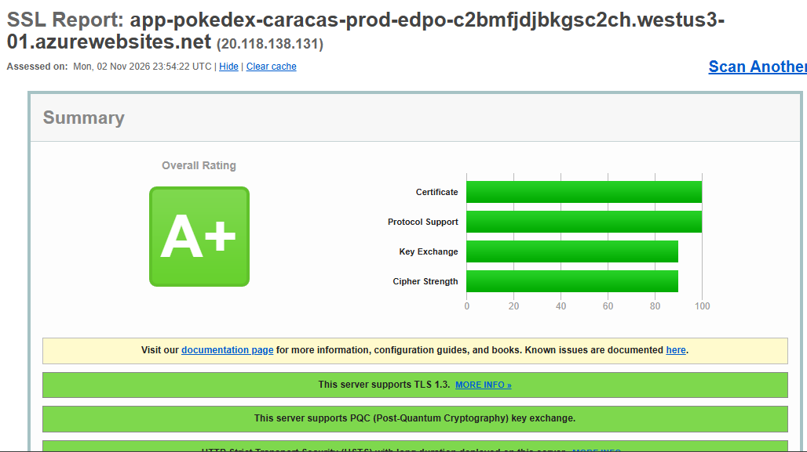
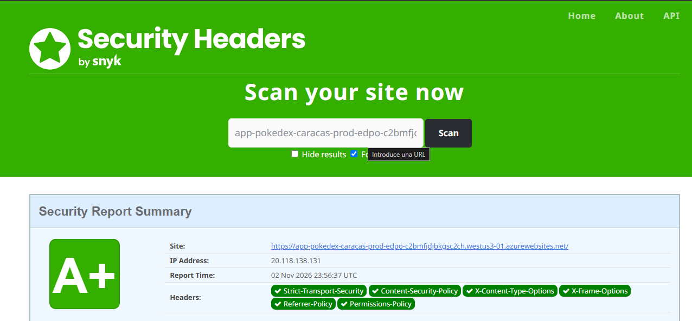

# Despliegue de PokeDex en Azure App Service

Este documento explica cómo se desplegó la aplicación **PokeDex** (Angular 14) en **Azure App Service (Windows)** usando **GitHub Actions**, y cómo se configuraron los encabezados de seguridad.

- **Repositorio:** https://github.com/EzequielPalencia/pokedex
- **App Service:** `app-pokedex-caracas-prod-edpo`
- **URL pública:** ``

La creación de la cuenta y la configuración inicial en Azure están en [README.md](README.md).

---

## 1. Prerrequisitos

| Herramienta | Uso |
|---|---|
| Git | Control de versiones |
| Node.js y npm | Instalación de dependencias y compilación |
| Cuenta de GitHub | Repositorio `pokedex` |
| Cuenta Azure for Students | Hospedaje (ver README.md) |
| Visual Studio Code / PowerShell | Edición y comandos |

---

## 2. Obtención del código fuente

El código original está en:
`https://github.com/rcuello/ac4dem1a/tree/master/sistemas-distribuidos/poke-dex-lab`

### 2.1 Descarga

Se descargó el repositorio del laboratorio y se tomó solo la carpeta `poke-dex-lab`:

```bash
git clone --depth 1 --filter=blob:none --sparse https://github.com/rcuello/ac4dem1a.git temp
cd temp
git sparse-checkout set sistemas-distribuidos/poke-dex-lab
```

### 2.2 Reorganización del repositorio

El proyecto Angular quedó anidado en `poke-dex-lab/source/pokedex-angular/`. Se movió su contenido a la **raíz** del repositorio para que `package.json`, `angular.json` y `src/` queden al nivel superior:

```bash
mkdir ../pokedex_tmp
mv poke-dex-lab/source/pokedex-angular/* ../pokedex_tmp/
mv poke-dex-lab/source/pokedex-angular/.[!.]* ../pokedex_tmp/
rm -rf poke-dex-lab
mv ../pokedex_tmp/* .
mv ../pokedex_tmp/.[!.]* .
rmdir ../pokedex_tmp
```

### 2.3 Subida al repositorio `pokedex`

```bash
git add -A
git commit -m "Código fuente inicial de PokeDex (Angular)"
git branch -M main
git remote add origin https://github.com/EzequielPalencia/pokedex.git
git push -u origin main
```

---

## 3. Análisis del proyecto

- **Tipo:** aplicación Angular 14 (necesita compilación con `npm run build`).
- **Salida de compilación:** `dist/pokedex-angular`.
- **APIs externas** (necesarias para el CSP):
  - `https://beta.pokeapi.co/graphql/v1beta` (GraphQL)
  - `https://pokeapi.co/api/v2` (REST)
  - `https://assets.pokemon.com` (imágenes oficiales)
- **Estilo del proyecto original:** pensado para GitHub Pages, con subcarpeta `/pokedex-angular/`.

---

## 4. Cambios realizados al código

### 4.1 Eliminación del workflow original

El proyecto traía `.github/workflows/pipelines.yml`, que ejecutaba pruebas y subía cobertura a Codecov. Se eliminó porque requiere un secreto (`CODECOV_TOKEN`) inexistente y no es un despliegue.

### 4.2 Ruta de las imágenes (`src/environments/environment.prod.ts`)

En Azure la aplicación vive en la raíz del sitio, no en `/pokedex-angular/`:

```ts
imagesPath: '/assets/images',
```

### 4.3 Eliminación del truco de GitHub Pages

- Se borró `src/404.html`.
- Se eliminó de `src/index.html` el script en línea `spa-github-pages`.
- Se quitó `src/404.html` de la lista de `assets` en `angular.json`.

Motivo: son scripts en línea que el CSP bloquea, y en IIS las rutas de la SPA se resuelven con `web.config`.

### 4.4 Sin estilos ni scripts en línea al compilar (`angular.json`)

En `build.configurations.production` se agregó:

```json
"optimization": {
  "scripts": true,
  "styles": {
    "minify": true,
    "inlineCritical": false
  },
  "fonts": false
},
```

Así Angular no inserta el CSS crítico ni el atributo `onload` en el HTML.

### 4.5 FontAwesome sin CSS en línea

En `src/main.ts`:

```ts
import { config } from '@fortawesome/fontawesome-svg-core';
config.autoAddCss = false;
```

En `src/styles.scss`:

```scss
@import '@fortawesome/fontawesome-svg-core/styles.css';
```

### 4.6 Inclusión de `web.config` en la salida del build

El archivo `src/web.config` se copia a `dist` con un asset de tipo glob, dentro de `architect.build.options.assets` en `angular.json`:

```json
"assets": [
  "src/favicon.ico",
  "src/og-image.jpg",
  "src/assets",
  { "glob": "web.config", "input": "src", "output": "/" }
],
```

---

## 5. Compilación local

```bash
npm install
npm run build
```

Verificaciones realizadas:

```powershell
Test-Path dist/pokedex-angular/web.config
Select-String -Path dist/pokedex-angular/index.html -Pattern "<script>|<style|onload="
```

- El primer comando debe responder `True`.
- El segundo debe salir vacío (HTML sin scripts ni estilos en línea).

La compilación muestra dos advertencias de tamaño (*budget*) que no impiden el despliegue.

---

## 6. Configuración del servidor: `src/web.config`

Azure App Service en Windows usa **IIS**, que lee `web.config`. Este archivo hace tres cosas: redirige HTTP a HTTPS, devuelve `index.html` para las rutas de Angular (evita el error 404) y agrega los encabezados de seguridad.

```xml
<?xml version="1.0" encoding="utf-8"?>
<configuration>
  <system.webServer>
    <rewrite>
      <rules>
        <rule name="HTTPS redirect" stopProcessing="true">
          <match url="(.*)" />
          <conditions>
            <add input="{HTTPS}" pattern="off" ignoreCase="true" />
          </conditions>
          <action type="Redirect" url="https://{HTTP_HOST}/{R:1}" redirectType="Permanent" />
        </rule>
        <rule name="Angular routes" stopProcessing="true">
          <match url=".*" />
          <conditions logicalGrouping="MatchAll">
            <add input="{REQUEST_FILENAME}" matchType="IsFile" negate="true" />
            <add input="{REQUEST_FILENAME}" matchType="IsDirectory" negate="true" />
          </conditions>
          <action type="Rewrite" url="/index.html" />
        </rule>
      </rules>
    </rewrite>
    <staticContent>
      <remove fileExtension=".woff" />
      <remove fileExtension=".woff2" />
      <mimeMap fileExtension=".woff" mimeType="font/woff" />
      <mimeMap fileExtension=".woff2" mimeType="font/woff2" />
    </staticContent>
    <httpProtocol>
      <customHeaders>
        <remove name="X-Powered-By" />
        <add name="Strict-Transport-Security" value="max-age=31536000; includeSubDomains; preload" />
        <add name="Content-Security-Policy" value="default-src 'self'; script-src 'self'; style-src 'self' 'unsafe-inline'; img-src 'self' data: https://assets.pokemon.com; font-src 'self'; connect-src 'self' https://beta.pokeapi.co https://pokeapi.co; object-src 'none'; base-uri 'self'; form-action 'self'; frame-ancestors 'none'" />
        <add name="X-Content-Type-Options" value="nosniff" />
        <add name="X-Frame-Options" value="DENY" />
        <add name="Referrer-Policy" value="strict-origin-when-cross-origin" />
        <add name="Permissions-Policy" value="camera=(), microphone=(), geolocation=(), payment=(), usb=()" />
        <add name="Cross-Origin-Opener-Policy" value="same-origin" />
        <add name="Cross-Origin-Resource-Policy" value="same-origin" />
      </customHeaders>
    </httpProtocol>
  </system.webServer>
</configuration>
```

### Explicación de los encabezados

| Encabezado | Función |
|---|---|
| `Strict-Transport-Security` | Obliga al navegador a usar siempre HTTPS |
| `Content-Security-Policy` | Limita desde qué orígenes se cargan scripts, estilos, imágenes y conexiones |
| `X-Content-Type-Options` | Impide que el navegador adivine el tipo de archivo |
| `X-Frame-Options` | Evita que el sitio se incruste en otro (clickjacking) |
| `Referrer-Policy` | Controla la información de origen enviada a otros sitios |
| `Permissions-Policy` | Desactiva cámara, micrófono, geolocalización, etc. |
| `Cross-Origin-Opener-Policy` / `Cross-Origin-Resource-Policy` | Aíslan el sitio de otros orígenes |

### Decisión sobre `style-src 'unsafe-inline'`

Con `style-src 'self'` estricto la aplicación se mostraba **sin estilos**, porque Angular inyecta el CSS de cada componente como etiquetas `<style>` en tiempo de ejecución. Se permitió `'unsafe-inline'` **solo en estilos**, y se mantuvo `script-src 'self'` estricto, que es la protección más importante contra XSS.

---

## 7. Despliegue continuo con GitHub Actions

Al conectar el App Service con GitHub, Azure generó un workflow. Ese workflow **no servía** para esta aplicación por tres motivos:

| Problema del workflow original | Corrección |
|---|---|
| `npm run test --if-present` ejecutaba `ng test`, que abre Chrome y nunca termina | Se eliminó el paso de pruebas |
| `path: .` subía todo el proyecto, no la app compilada | Se sube solo `dist/pokedex-angular` |
| Compilación en Windows con Node 22 | Se compila en Ubuntu con Node 18 (compatible con Angular 14) |

### Workflow final (`.github/workflows/`)

```yaml
name: Build and deploy Node.js app to Azure Web App - app-pokedex-caracas-prod-edpo

on:
  push:
    branches:
      - 'main'
  workflow_dispatch:

jobs:
  build:
    runs-on: ubuntu-latest
    permissions:
      contents: read
    env:
      HUSKY: 0

    steps:
      - uses: actions/checkout@v4

      - name: Set up Node.js version
        uses: actions/setup-node@v4
        with:
          node-version: '18.x'

      - name: npm install and build
        run: |
          npm ci
          npm run build

      - name: Upload artifact for deployment job
        uses: actions/upload-artifact@v4
        with:
          name: node-app
          path: dist/pokedex-angular

  deploy:
    runs-on: ubuntu-latest
    needs: build
    permissions:
      id-token: write
      contents: read

    steps:
      - name: Download artifact from build job
        uses: actions/download-artifact@v4
        with:
          name: node-app

      - name: Login to Azure
        uses: azure/login@v2
        with:
          client-id: ${{ secrets.AZUREAPPSERVICE_CLIENTID_6C11744DFB1B4F179D6A0E74D89EBDCB }}
          tenant-id: ${{ secrets.AZUREAPPSERVICE_TENANTID_CBCA55650ACA4EACB5B1D7DEF4C8ABF7 }}
          subscription-id: ${{ secrets.AZUREAPPSERVICE_SUBSCRIPTIONID_6B7C3DDFC91D479AB36923DFB13D0509 }}

      - name: Deploy to Azure Web App
        uses: azure/webapps-deploy@v3
        with:
          app-name: 'app-pokedex-caracas-prod-edpo'
          slot-name: 'Production'
          package: .
```

Notas:

- `HUSKY: 0` evita que el hook `prepare` de Husky falle en el servidor de integración.
- Los secretos (`AZUREAPPSERVICE_*`) los creó Azure automáticamente en el repositorio al conectar GitHub. No se escriben valores en el código.


---

## 8. Publicación de los cambios

```powershell
git add -A
git commit -m "fix: incluye web.config en la salida del build"
git push
```

Si Husky bloquea el commit, se puede desactivar solo en la sesión actual:

```powershell
$env:HUSKY = 0
```

Cada `push` a `main` ejecuta el workflow y actualiza el sitio en Azure en unos 2 a 3 minutos.

---

## 9. Verificación de la aplicación

1. Abrir la URL del App Service.
2. Comprobar que cargan el listado de Pokémon, las imágenes, la búsqueda y el detalle.
3. Abrir la consola del navegador (F12) y revisar que no haya errores de CSP (`Refused to ...`).
4. Probar una ruta interna, por ejemplo la de detalle de un Pokémon, y recargar con F5 para confirmar que no da 404.


---

## 10. Escaneo de seguridad

### 10.1 SecurityHeaders.com

1. Entrar a https://securityheaders.com
2. Escribir la URL de la aplicación y pulsar **Scan**.
3. Capturar la calificación y la tabla de encabezados.

| Momento | Calificación |
|---|---|
| Resultado obtenido | `[COMPLETAR: A+ / A / B ...]` |



### 10.2 Revisión avanzada (opcional)

**SSL Labs:** https://www.ssllabs.com/ssltest

| Herramienta | Resultado |
|---|---|
| SSL Labs | `[COMPLETAR: calificación]` |
| OWASP ZAP (opcional) | `[COMPLETAR: hallazgos]` |



---

## 11. Problemas encontrados y soluciones

| # | Problema | Causa | Solución |
|---|---|---|---|
| 1 | No se encontraba `src` ni `package.json` | El proyecto estaba anidado en `poke-dex-lab/source/pokedex-angular/` | Se movió el contenido a la raíz del repositorio |
| 2 | Workflow original fallaba | Usaba Codecov con un secreto inexistente | Se eliminó `pipelines.yml` |
| 3 | Static Web Apps no disponible | La suscripción de estudiante restringe la región | Se usó Azure App Service |
| 4 | El workflow de Azure se quedaba colgado | `npm run test` abre Chrome y nunca termina | Se eliminó el paso de pruebas |
| 5 | Riesgo de 404 en el sitio | El workflow subía todo el proyecto en lugar de `dist` | Se cambió `path` a `dist/pokedex-angular` |
| 6 | `web.config` no llegaba a `dist` | El asset estaba en el bloque `test` de `angular.json`, no en `build` | Se agregó el asset glob en `build.options.assets` |
| 7 | El commit era bloqueado | ESLint (hook de Husky) no puede leer SCSS | Se desactivaron los hooks con `HUSKY=0` en la sesión |
| 8 | Aplicación sin estilos | El CSP bloqueaba los estilos en línea de Angular | Se agregó `'unsafe-inline'` solo en `style-src` |
| 9 | Imágenes locales con 404 | `imagesPath` apuntaba a `/pokedex-angular/` de GitHub Pages | Se cambió a `/assets/images` |

---

## 12. Comandos de referencia

```bash
# Instalar dependencias
npm install

# Compilar para producción
npm run build

# Ejecutar en local
npm start
```

| Elemento | Valor |
|---|---|
| Carpeta de salida | `dist/pokedex-angular` |
| Servidor | IIS (Azure App Service, Windows) |
| Región | West US 3 |
| Grupo de recursos | `rg-pokedex-venezuela-prod` |